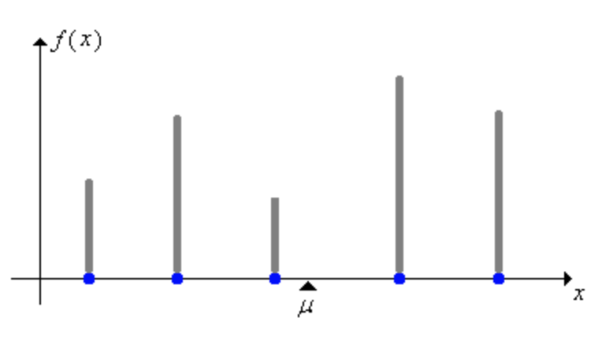
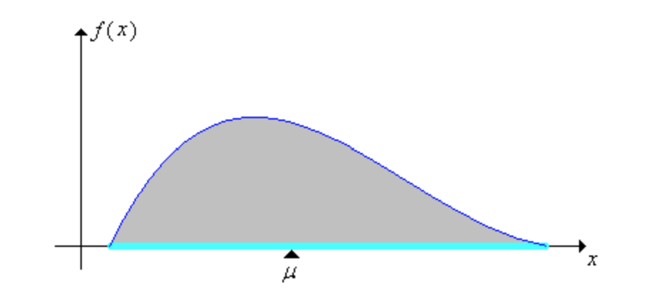

<!-- TODO: remove this comment when all the probability parts are draft: false
- [Probability Part I]()
- [Probability Part II]() $\leftarrow$ you are here
- [Probability Part III]()
-->

$$
\gdef\dx{\mathrm{d}x}
\gdef\dm{\mathrm{d}m}
\gdef\dr{\mathrm{d}r}
$$

$\gdef\dx{\mathrm{d}x}$
$\gdef\dm{\mathrm{d}m}$
$\gdef\dr{\mathrm{d}r}$


## Intro

Last time, in [Part I](), we covered the basic concepts leading up to **random variables** and their distributions. In this post, things will start to get cracking as we build up to the **law of the unconscious statistician**, the **law of large numbers**, and **Monte Carlo integration**. Along the way, we'll introduce the following terms:



| Term                                         | Notation                        |
| ---                                          | :---:                           |
| Expected Value of $X$ under distribution $p$ | $\mathbb{E}_p[X]$               |
| Variance of $X$ under distribution $p$       | $\mathbb{V}_p[X]$               |

## Expected Value

The **expected value** $\mathbb{E}_p[X]$ of a **random variable** $X$ with distribution $p$ is the probability-weighted average of its possible values. Intuitively, it represents the average value we would observe over many _independent_ repetitions of the same experiment.



For a discrete **random variable**: 


$$
\mathbb{E}_p[X] = \sum_x x \,  p(x)
$$


The sum is taken over all possible values $x$ of $X$. Here, $p(x)$ is the **probability mass function** (PMF) $p_X(x)$, the probability that $X=x$.



For a continuous **random variable**:



$$
\mathbb{E}_p[X] = \int x \,  p(x) \, \dx
$$


The integral is taken over all possible values $x$ of $X$. Here, $p(x)$ is the **probability density function** (PDF) $f_X(x)$, the probability density at $x$.



---

Note: The **expected value** of a contant $c\in\mathbb{R}$ is the constant itself. \
The constant $c$ can be thought of as a discrete **random variable** that takes the value $c$ with probability $1$.
$$
\mathbb{E}[c]=c
$$

---



The **expected value** of $X$ is also called the _mean_ of the distribution of $X$ and is frequently denoted $\mu$. In physics, the mean is the center of mass, the balance point.




### Moment

The **moment** of $X$ about $a \in \mathbb{R}$ of order $n \in \mathbb{N}$ is defined as
$$
\mathbb{E}\big[ (X-a)^n \big]
$$

|                                                                        |                                   |
| ---                                                                    | ---                               |
| **Moments** about $0$ are referred to as _moments_, or _raw moments_.  | $ \mathbb{E}[ X^n ]$              |
| **Moments** about $\mu = \mathbb{E}[X]$ are referred to as _central moments_.          | $\mathbb{E}\big[ (X-\mu)^n \big]$ |



Note that the _first central moment_ is always $0$, as


$$
\begin{aligned}
\mathbb{E}\big[(X-\mu)^1\big] &= \mathbb{E}[X] - \mathbb{E}[\mu] \\
                              &= \mathbb{E}[X] - \mu             \\
                              &= 0
\end{aligned}
$$


We will revisit **moments** when we discuss **variance**.

### Example: Fair Die

Let's get the **expected value** of a fair die roll.



First, let $S=T=\lbrace 1,2,3,4,5,6 \rbrace$ and define our **random variable** $X : S \to T$ as an identity mapping. The measurement $X(s) = s $ is simply the number rolled.



Since the die is fair, the **PMF** $p(x) = \dfrac{1}{6}$ for each possible value of $x$. The **expected value** is:


$$
\begin{aligned}
\mathbb{E}_p[X] &= \sum_x x \,  p(x)                   \\[1em]
                &= ( 1 )( \frac{1}{6} ) + 
                   ( 2 )( \frac{1}{6} ) + 
                   ( 3 )( \frac{1}{6} ) + 
                   ( 4 )( \frac{1}{6} ) + 
                   ( 5 )( \frac{1}{6} ) + 
                   ( 6 )( \frac{1}{6} )                \\[1em]
                &= \frac{ 1 + 2 + 3 + 4 + 5 + 6 }{ 6 } \\[1em]
                &= \frac{ 21 }{ 6 }                     \\[1em]
                &= 3.5
\end{aligned}
$$


Although we can't actually roll the value $3.5$, it represent the average value we would approach over many indepedent rolls.

### Example: Weighted Die

Now let's say we're gambling for money, and higher rolls win.  To give give ourselves a little bit of a unfair advantage, we bring out a weighted die where the probability of rolling a $6$ is twice as likely as rolling any of the other numbers.


$$
p(x) = \begin{cases}
            \dfrac{1}{7}, \, x \in \lbrace 1, 2, 3, 4, 5 \rbrace \\[2em]
            \dfrac{2}{7}, \, x = 6 
          \end{cases}
$$


The **expected value** is then:

$$
\begin{aligned}
\mathbb{E}_p[X] &= \sum_x x \,  p(x)                     \\[1em]
                &= ( 1 )( \frac{1}{7} ) + 
                   ( 2 )( \frac{1}{7} ) + 
                   ( 3 )( \frac{1}{7} ) + 
                   ( 4 )( \frac{1}{7} ) + 
                   ( 5 )( \frac{1}{7} ) + 
                   ( 6 )( \frac{2}{7} )                  \\[1em]
                &= \frac{ 1 + 2 + 3 + 4 + 5 + 2(6)}{ 7 } \\[1em]
                &\approx 3.86
\end{aligned}
$$


So our weighted die has an **expected value** of approximately $3.86$, a little higher than the fair die's **expected value** of $3.5$.


### Example: Dart throw

Now let's look at the **expected value** of a continuous **random variable**. We're going to reuse the [dart throwing experiment]() from part 1, where a dart lands uniformly over the area of a circular target of radius $R$. The **random variable** $X$ measures the distance from the bullseye, and we've already derived the PDF $p(r)$ as:


$$
p(r) = \begin{cases}
            \dfrac{2r}{R^2}, \quad 0 < r < R \\[1em]
            0, \quad \text{otherwise}
          \end{cases}
$$


The **expected value** $\mathbb{E}_p[X]$ is calculated as follows:


$$
\begin{aligned}
\mathbb{E}_p[X] &= \int _0^R r \,  p(r) \, \dr                      \\[1em]
                &= \int _0^R r \,  ( \frac{2r}{R^2} )  \, \dr       \\[1em]
                &= \frac{2}{R^2} \int _0^R r^2  \, \dr              \\[1em]
                &= \frac{2}{R^2} \left[ \frac{r^3}{3} \right] _0^R  \\[1em]
                &= \frac{2}{R^2} ( \frac{R^3}{3} )                  \\[1em]
                &= \frac{2}{3} R
\end{aligned}
$$


So on average, we would expect the dart to land two-thirds of the way from the center to the edge.

## Law of Large Numbers

If we _sample from the distribution of $X$_, that is re-run the same experiment independently, we create a sequence of **random variables** $(X_1, X_2, \dots)$ each with the same distribution as $X$. The _sample mean_ $\overline{X}_n$ after $n$ runs is:

$$
\overline{X}_n = \frac{1}{n} \sum _{i=1}^n X_i
$$

$\overline{X}_n$ is itself a **random variable**, whose realized value is the average of the realized values of $X_1, \dots, X_n$.



The **law of large numbers** (LLN) informally states that as the number of samples increases, the _sample mean_ converges to the **expected value**.


$$
\overline{X}_n 
\xrightarrow[n \to \infty]{}
\mathbb{E}_p[X]
$$



## Law of the Unconscious Statistician

The **law of the unconscious statistician** (LOTUS) is a theorem for finding the **expected value** of a _function_ $g$ of a **random variable** $X$.  It is so named because people often use it without consciously realizing that it requires a theorem.




Applying $g$ to $X$ produces another **random variable** $g(X)$, which has its own **probability distribution**. However, the distribution of $g(X)$ is not needed: **LOTUS** shows us that the **expected value** $\mathbb{E}[g(X)]$ can be computed using only the distribution of $X$.



The discrete case with **PMF** $p_X$ is:


$$
\mathbb{E}_{p_X}[g(X)] = \sum_x g(x) \, p_X(x)
$$


And the continuous case with **PDF** $f_X$ is:


$$
\mathbb{E}_{f_X}[g(X)] = \int g(x) \, f_X(x) \, \dx
$$



## Variance

The **variance** of $X$ is defined as the _second central moment_ of $X$, where $\mu = \mathbb{E} [  X ]$:



$$
\begin{aligned}
\operatorname{Var}(X)
&= \mathbb{E}\left[(X-\mu)^2\right] \\
&= \mathbb{E}\left[X^2-2\mu X+\mu^2\right] \\
&= \mathbb{E}[X^2]- \mathbb{E}[2\mu X]+ \mathbb{E}[ \mu^2 ] \\
&= \mathbb{E}[X^2]-2\mu^2 + \mu^2 \\
&= \mathbb{E}[X^2]-\mu^2
\end{aligned}
$$


If $X$ is discrete with PMF $p_X$, then:


$$
\operatorname{Var}_{p_X}(X) = \sum _{x \in S} (x-\mu)^2 \, p_X(x)
$$


If $X$ is continuous with PDF $f_X$, then:


$$
\operatorname{Var}_{f_X}(X) = \int _S (x - \mu)^2 \, f_X(x) \, \dx
$$



**Variance** is often denoted as $\sigma^2$, and its positive square root, **standard deviation**, as $\sigma$.


### Aside: Moment of Inertia




In physics, the _moment of inertia_ $I_\mu$ of a mass distribution along a line measures its resistance to rotation about its center of mass $\mu$.


$$
\begin{aligned}
I_\mu &= \int (x-\mu)^2 \, \dm               \\
      &= \int (x-\mu)^2 \, \rho(x) \, \dx ,
\end{aligned}
$$


where:



| Quantity           | Expression                          |
| ---                | ---                                 |
| Position           | $x$                                 |
| Differential mass  | $\dm=\rho(x) \thinspace \dx$        |
| Mass density       | $\rho(x)$                           |
| Differential width | $\dx$                               |



For the probability analogue, normalize the mass density by its total mass to obtain a **PDF**:



| Quantity           | Expression                          |
| ---                | ---                                 |
| Total mass         | $M = \int \rho(x) \thinspace \dx$   |
| PDF                | $f_X(x) = \dfrac{\rho(x)}{M}$       |



Then, the **variance** is equal to the _moment of inertia_ divided by total mass:


$$
\begin{aligned}
\operatorname{Var}_{f_X}(X) &= \mathbb{E}_{f_X} \left[ (X-\mu)^2 \right]  \\
                            &= \int (x-\mu)^2 \, f_X(x) \, \dx             \\
                            &= \int (x-\mu)^2 \, \frac{\rho(x)}{M} \, \dx  \\
                            &= \frac{I_\mu}{M}.
\end{aligned}
$$



Sneak peek for the 3D _inertia tensor_, after normalizing the mass density into a **PDF**:


$$
\begin{aligned}
\operatorname{Cov}(\mathbf X)
&= \mathbb E\left[(\mathbf X-\boldsymbol\mu)^{\otimes 2}\right] \\[1em]
&=
\begin{bmatrix}
\operatorname{Var}(X_1) & \operatorname{Cov}(X_1,X_2) & \operatorname{Cov}(X_1,X_3) \\
\operatorname{Cov}(X_2,X_1) & \operatorname{Var}(X_2) & \operatorname{Cov}(X_2,X_3) \\
\operatorname{Cov}(X_3,X_1) & \operatorname{Cov}(X_3,X_2) & \operatorname{Var}(X_3)
\end{bmatrix}\\[2em]
&= \frac{\operatorname{tr}(\mathbf I_\mu)\mathbf 1-\mathbf I_\mu}{2M}.
\end{aligned}
$$


## Monte Carlo Integration

It's time for the big boy, **Monte Carlo integration**!



Monte Carlo techniques use repeated random sampling, and are so named after the famous Casino de Monte-Carlo in Monaco. **Monte Carlo integration** is a clever technique that rewrites an integral as an **expected value**, and approximates it with a _sample mean_.


$$
\widehat{I}^{(n)}
=
\frac{1}{n}\sum_{i=1}^n\frac{f(X_i)}{p(X_i)}
\approx
\int f(x) \thinspace \dx
$$


### Derivation

We want to estimate the __integral__ $I$ of a __function__ $f$:

$$
I = \int f(x) \thinspace \dx.
$$

Do we have anything in our toolbox that contains an __integral__ of a __function__?\
We do! By **LOTUS**, the **expected value** of a function $g(X)$ is:
$$
\mathbb{E}_p\left[g(X)\right] = \int g(x) \thinspace p(x) \thinspace \dx
$$

Let's set that **expected value** equal to $I$.

$$
\mathbb{E}_p\left[g(X)\right] = \int g(x) \thinspace p(x) \thinspace \dx = \int f(x) \thinspace \dx = I
$$

Now we have a relationship between $g$, $f$, and $p$:
$$
g(x) \thinspace p(x)=f(x).
$$

Solving for $g$, we can rewrite our **expected value** in terms of the function $f$ we're trying to integrate, and any **PDF** $p$ that can sample where $f$ is nonzero. We no longer need $g$.

$$
\mathbb{E}_p\left[\frac{f(X)}{p(X)}\right] = \int f(x) \thinspace \dx = I.
$$

Now the **LLN** informally tells us that the _sample mean_ converges to the **expected value**.

Define the single-sample **random variable**

$$
\widehat{I}^{(1)} = \frac{f(X)}{p(X)} , \qquad
\mathbb{E}_p\left[\widehat{I}^{(1)}\right]
= I.
$$

Then draw independent samples $(X_1, \dots, X_n)$ from $p$. Each sample gives an independent single-sample estimate:

$$
\widehat{I}_i^{(1)} = \frac{f(X_i)}{p(X_i)}.
$$

Their _sample mean_ converges to $I$:


$$
\begin{aligned}
\widehat{I}^{(n)}
&= \frac{1}{n} \sum_{i=1}^n \widehat{I}_i^{(1)}
&&\xrightarrow[n \to \infty]{}
\mathbb{E}_p\left[ \widehat{I}^{(1)}\right] \\[1em]

&= \frac{1}{n} \sum_{i=1}^n \frac{f(X_i)}{p(X_i)}
&&\xrightarrow[n \to \infty]{}
I
\end{aligned}
$$



This gives us the full definition of **Monte Carlo integration**


$$
\widehat{I}^{(n)}
=
\frac{1}{n}\sum_{i=1}^n\frac{f(X_i)}{p(X_i)}
\approx
\int f(x) \thinspace \dx
$$


### Example: Sum of a vector

Say we want to compute the sum $S$ of the numbers in a vector
$$
v=( 10, 13, 43, 74, 25 )
$$

$$
S = \sum_{k=1}^{5} v_k
$$

We could use a simple loop,

```cpp
#include <array>
#include <iostream>
#include <numeric>
int main()
{
    const std::array v { 10, 13, 43, 74, 25 };
    const int S { std::accumulate( v.begin(), v.end(), 0 ) };
    std::cout << "S = " << S << '\n';
}
```

```txt
S = 165
```

but that's _stupid_. We want to do this with **Monte Carlo integration**, with a million samples.



The Monte Carlo estimator also works for finite sums.


$$
\widehat{S}^{(n)}
=
\frac{1}{n}\sum_{i=1}^n\frac{v_{X_i}}{p(X_i)} \approx \sum_{k=1}^5 v_k
$$


The **random variable** $X$ is uniform over $(1, 2, 3, 4, 5)$, so its distribution is
$$
p(X_i)=\frac{1}{5}.
$$

Here, $v_{X_i}$ is a random element of the vector $v$, selected using the random sample index $X_i$.  Thus our estimator becomes:

$$
\begin{aligned}
\widehat{S}^{(n)}
&=
\frac{1}{n}\sum_{i=1}^n\frac{v_{X_i}}{ ( \frac{1}{5} )} \\[2em]
&=\frac{5}{n}\sum_{i=1}^n v_{X_i}.
\end{aligned}
$$


Then our code becomes 
```cpp
#include <array>
#include <iostream>
#include <numeric>
#include <random>
#include <span>

float EstimateSum( std::span< const int > v, const int n = 1000000 )
{
   std::default_random_engine rng{ 0 };
   std::uniform_int_distribution< int > X{ 0, ( int )v.size() - 1 };

   int result{};
   for( int i{}; i < n; ++i )
      result += v[ X( rng ) ];
      
   return ( 5.0f / n ) * result;
}

int main()
{
    const std::array v { 10, 13, 43, 74, 25 };
    const float S { EstimateSum( v ) };
    std::cout << "S is approximately equal to " << S << '\n';
}
```

```txt
S is approximately equal to 164.873
```

### Example: $\int_0^\pi \sin(x) \thinspace \mathrm{d}x$

Let's find an _estimator_ $\widehat{I}^{(n)}$ for the integral

$$
\widehat{I}^{(n)} \approx \int_0^\pi \sin(x) \thinspace \dx
$$

According to **Monte Carlo integration**, we can estimate an integral by averaging the values $\dfrac{f(X_i)}{p(X_i)}$.

$$
\widehat{I}^{(n)}
=
\frac{1}{n}\sum_{i=1}^n\frac{f(X_i)}{p(X_i)}
\approx
\int f(x) \thinspace \dx
$$


We already have $f(x) = \sin(x)$, the function we want to integrate. We need to draw samples $X_i$ from a **random variable** $X$ with an appropriate **PDF** $p$. We'll let $X$ be uniformly distributed on the integration bounds $[0, \pi]$, so its **PDF** is
$$
p(x) = \frac{1}{ \pi }.
$$

Samples $X_i$ are easy to generate: draw a uniform random number from $0$ to $\pi$.

The _estimator_ is thus:


$$
\begin{aligned}
\widehat{I}^{(n)}
&= \frac{1}{n}\sum_{i=1}^n\frac{f(X_i)}{p(X_i)} \\[1em]
&= \frac{1}{n} \sum _{i=1}^n \frac{ \left( \sin(X_i) \right) }{ \left( \dfrac{1}{\pi} \right) }\\[1em]
&= \frac{\pi}{n} \sum _{i=1}^n \sin(X_i)
\end{aligned}
$$


The intuition is that, because $p$ is uniform, our _estimator_ approximates the area under the curve as the width of the interval times the average height of the function.


$$
\widehat{I}^{(n)}
=
\underbrace{\pi}_{\text{width}}
\cdot
\underbrace{\frac{1}{n}\sum_{i=1}^n\sin(X_i)}_{\text{average height}}
$$



```cpp
#include <cmath>
#include <iostream>
#include <numbers>
#include <random>

float EstimateIntegral( const int n = 1000000 )
{
   std::default_random_engine rng{ 0 };
   std::uniform_real_distribution< float > X{ 0, std::numbers::pi_v< float > };

   float result{};
   for( int i{}; i < n; ++i)
      result += std::sin( X( rng ) );

   return ( std::numbers::pi_v<float> / n ) * result;
}

int main()
{
   std::cout << "Integral estimate: " << EstimateIntegral() << std::endl;
}
```

```txt
Integral estimate: 2.00179
```
 
## Coming up next

We now have the basic structure for **Monte Carlo integration**. In part 3 we will look at sampling using the inversion method and importance sampling.

## Sources

- [Definitions and Basic Properties - Kyle Siegrist, LibreTexts](https://stats.libretexts.org/Bookshelves/Probability_Theory/Probability_Mathematical_Statistics_and_Stochastic_Processes_(Siegrist)/04%3A_Expected_Value/4.01%3A_Definitions_and_Basic_Properties)

- [Variance - Kyle Siegrist, LibreTexts](https://stats.libretexts.org/Bookshelves/Probability_Theory/Probability_Mathematical_Statistics_and_Stochastic_Processes_(Siegrist)/04%3A_Expected_Value/4.03%3A_Variance)


