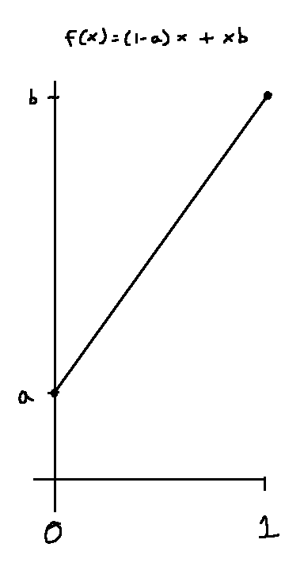

<!-- TODO: remove this comment when all the probability parts are draft: false
- [Probability Part I]()
- [Probability Part II]()
- [Probability Part III]() $\leftarrow$ you are here
-->

$$
\gdef\dx{\mathrm{d}x}
\gdef\dm{\mathrm{d}m}
\gdef\dr{\mathrm{d}r}
\gdef\iidsim{\overset{\mathrm{iid}}{\sim}}
$$

$\gdef\dx{\mathrm{d}x}$
$\gdef\dm{\mathrm{d}m}$
$\gdef\dr{\mathrm{d}r}$
$\gdef\iidsim{\overset{\mathrm{iid}}{\sim}}$

## Intro

In [Parts I](), and [II](), we built up from the basics to **random variables** and **Monte Carlo integration**. In this post we will expand on **Monte Carlo integration**.

## Inversion Method Sampling

Recall that **Monte Carlo integration** tells us that we can estimate an integral but averaging 
**random variables** divided by their probability distributions.


$$
\widehat{I}^{(n)}
=
\frac{1}{n}\sum_{i=1}^n\frac{f(X_i)}{p(X_i)}
\approx
\int f(x) \thinspace \dx
$$


However, these random samples must still be drawn from said distribution? How do we do that? One important method is the **inversion method**, which maps uniform samples from $[0,1)$ to the given probability distribution by inverting the CDF.

There's a couple things I want to elaborate on related to https://pbr-book.org/4ed/Monte_Carlo_Integration/Sampling_Using_the_Inversion_Method.

In the example where they sample a linear function defined over $[0,1]$, given $a,b>=0$
$$
f(x) = (1-x)a + xb
$$

Here, $f(x)$ is an unnormalized density that defines the shape of the distribution we want to sample from, _not_ the integral we are trying to esatimate using Monte Carlo.

- The x-axis here is the sample value $x$.
- The y-axis here is the unnormalized "weight" of the sample. We want to normalize it to get a **PDF** $p(x)$.

So the first thing they do here is integrate the function. This isn't to compute the CDF, the goal here instead is to get the total "weight". The inverse of this weight is a normalization constant - multiplying the original function by the normalization constant produces a function whose integral is $1$, this way it can be used as a PDF. 

This integral is given by


$$
\begin{aligned}
\int_0^1 f(x) \, \dx &= \int_0^1 \left( (1-x)a+xb \right) \, \dx
             \\[1em] &= a \int_0^1 (1-x) \, \dx + b \int_0^1 x \, \dx
             \\[1em] &= a \left[ x - \frac{x^2}{2} \right]_0^1 +  b \left[ \frac{x^2}{2} \right]_0^1
             \\[1em] &= \frac{a}{2} + \frac{b}{2}
             \\[1em] &= \frac{a+b}{2}.
\end{aligned}
$$


So $f(x)$ is normalized by dividing by its integral to give the PDF


$$
\begin{aligned}
p(x) &= \frac{ f(x)  }{\int_0^1 f(x) \, \dx}  \\[1em]
     &= \frac{ f(x)  }{ \left( \frac{a+b}{2} \right)  }  \\[1em]
     &= \frac{ 2 f(x) }{ a+b}.
\end{aligned}
$$


Now the PDF can be integrated from $0$ to $x$ to give its CDF


$$
\begin{aligned}
P(x)    &= \int_0^x p(x') \, \dx'
\\[1em] &= \int_0^x \left( \frac{ 2 f(x') }{ a+b} \right) \dx'
\\[1em] &= \frac{2}{a+b} \int_0^x  f(x') \, \dx'
\\[1em] &= \frac{2}{a+b} \int_0^x \left( (1-x')a+x' b \right) \, \dx'
\\[1em] &= \frac{2}{a+b} \left( a \int_0^x (1-x') \, \dx' + b \int_0^x x' \, \dx' \right)
\\[1em] &= \frac{2}{a+b} \left( a \left[ x' - \frac{x'^2}{2} \right]_0^x + b \left[ \frac{x'^2}{2} \right]_0^x \right)
\\[1em] &= \frac{2}{a+b} \left( a \left[ x - \frac{x^2}{2} \right]     + b \left[ \frac{x^2}{2} \right]     \right)
\\[1em] &= \frac{ a \left[ 2x - x^2 \right] + b x^2  }{a+b} 
\\[1em] &= \frac{ x\left( a \left[ 2 - x \right] + b x \right) }{a+b} 
\end{aligned}
$$


Inverting $\xi=P(X)$ to solve for $X$ is the same as in PBRT.

## Expected Value Importance Sampling

Note:
- $X\sim p$ means samples $X$ are drawn from distribution $p$.
- $X\sim q$ means samples $X$ are drawn from distribution $q$.

An estimator can estimate an integral, an expected value, or other quantities. An estimator for an integral of a function looks like


$$
\begin{aligned}
I &= \int f(x) \, \dx
\\[1em] \hat{I} &= \frac{1}{n} \sum_{i=1}^n \frac{ f(X_i) }{p(X_i)}, \quad X_i \iidsim p.
\end{aligned}
$$


Whereas an estimator for the **expected value** of a function of a **random variable** is slightly different:


$$
\begin{aligned}
\mu &= E_p[ f(X) ] = \int f(x) \thinspace p(x) \thinspace \dx
\\[1em] \hat{\mu} &= \frac{1}{n} \sum_{i=1}^n f(X_i), \quad X_i \iidsim p.
\end{aligned}
$$


For the second estimator $\hat{\mu}$, choosing a **PDF** $q$ instead whose shape approximates $|f(x)| \thinspace p(x)$ can reduce variance. Note that 
$q(x) $ is required to be $> 0$ wherever $f(x)\thinspace p(x) \neq 0$.


$$
\begin{aligned}
E_p[ f(X) ] &= \int f(x) \thinspace p(x) \thinspace \dx
\\[1em] &= E_q \left[ \frac{ f(X) \thinspace p(X)}{ q(X) } \right]
\\[1em] &\approx \frac{1}{n} \sum_{i=1}^n \frac{ f(X_i) \thinspace p(X_i)  } { q(X_i) }, \quad X_i \iidsim q
\end{aligned}
$$


A couple terms here:

|                         |                      |
| ---                     | ---                  |
| likelihood ratio        | $\dfrac{p(x)}{q(x)}$ |
| nominal distribution    | $p$                  |
| importance distribution | $q$                  |

 
## Coming up next

## Sources

- [Sampling Using the Inversion Method - PBRT, 4th ed.](https://pbr-book.org/4ed/Monte_Carlo_Integration/Sampling_Using_the_Inversion_Method)

- [Improving Efficiency - PBRT, 4th ed.](https://pbr-book.org/4ed/Monte_Carlo_Integration/Improving_Efficiency)

- [Importance Sampling - Monte Carlo Theory, Methods and Examples, Art B. Owen, ch. 9](https://artowen.su.domains/mc/Ch-var-is.pdf)

