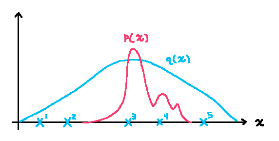

<!-- TODO: remove this comment when all the probability parts are draft: false
- [Probability Part I]()
- [Probability Part II]()
- [Probability Part III]() $\leftarrow$ you are here
-->

$$
\gdef\dx{\mathrm{d}x}
\gdef\dm{\mathrm{d}m}
\gdef\dr{\mathrm{d}r}
\gdef\iidsim{\overset{\mathrm{iid}}{\sim}}
$$

$\gdef\dx{\mathrm{d}x}$
$\gdef\dm{\mathrm{d}m}$
$\gdef\dr{\mathrm{d}r}$
$\gdef\iidsim{\overset{\mathrm{iid}}{\sim}}$

## Intro

In [Parts I](), and [II](), we built up from the basics to **random variables** and **Monte Carlo integration**. In this post we will expand on **Monte Carlo integration**.

## Inversion Method Sampling

Recall that **Monte Carlo integration** tells us that we can estimate an integral but averaging 
**random variables** divided by their probability distributions.


$$
\widehat{I}^{(n)}
=
\frac{1}{n}\sum_{i=1}^n\frac{f(X_i)}{p(X_i)}
\approx
\int f(x) \thinspace \dx
$$


However, these random samples must still be drawn from said distribution? How do we do that? One important method is the **inversion method**, which maps uniform samples from $[0,1)$ to the given probability distribution by inverting the CDF.

There's a couple things I want to elaborate on related to https://pbr-book.org/4ed/Monte_Carlo_Integration/Sampling_Using_the_Inversion_Method.

In the example where they sample a linear function defined over $[0,1]$, given $a,b>=0$
$$
f(x) = (1-x)a + xb
$$

Here, $f(x)$ is an unnormalized density that defines the shape of the distribution we want to sample from, _not_ the integral we are trying to esatimate using Monte Carlo.

- The x-axis here is the sample value $x$.
- The y-axis here is the unnormalized "weight" of the sample. We want to normalize it to get a **PDF** $p(x)$.

So the first thing they do here is integrate the function. This isn't to compute the CDF, the goal here instead is to get the total "weight". The inverse of this weight is a normalization constant - multiplying the original function by the normalization constant produces a function whose integral is $1$, this way it can be used as a PDF. 

This integral is given by


$$
\begin{aligned}
\int_0^1 f(x) \, \dx &= \int_0^1 \left( (1-x)a+xb \right) \, \dx
             \\[1em] &= a \int_0^1 (1-x) \, \dx + b \int_0^1 x \, \dx
             \\[1em] &= a \left[ x - \frac{x^2}{2} \right]_0^1 +  b \left[ \frac{x^2}{2} \right]_0^1
             \\[1em] &= \frac{a}{2} + \frac{b}{2}
             \\[1em] &= \frac{a+b}{2}.
\end{aligned}
$$


So $f(x)$ is normalized by dividing by its integral to give the PDF


$$
\begin{aligned}
p(x) &= \frac{ f(x)  }{\int_0^1 f(x) \, \dx}  \\[1em]
     &= \frac{ f(x)  }{ \left( \frac{a+b}{2} \right)  }  \\[1em]
     &= \frac{ 2 f(x) }{ a+b}.
\end{aligned}
$$


Now the PDF can be integrated from $0$ to $x$ to give its CDF


$$
\begin{aligned}
P(x)    &= \int_0^x p(x') \, \dx'
\\[1em] &= \int_0^x \left( \frac{ 2 f(x') }{ a+b} \right) \dx'
\\[1em] &= \frac{2}{a+b} \int_0^x  f(x') \, \dx'
\\[1em] &= \frac{2}{a+b} \int_0^x \left( (1-x')a+x' b \right) \, \dx'
\\[1em] &= \frac{2}{a+b} \left( a \int_0^x (1-x') \, \dx' + b \int_0^x x' \, \dx' \right)
\\[1em] &= \frac{2}{a+b} \left( a \left[ x' - \frac{x'^2}{2} \right]_0^x + b \left[ \frac{x'^2}{2} \right]_0^x \right)
\\[1em] &= \frac{2}{a+b} \left( a \left[ x - \frac{x^2}{2} \right]     + b \left[ \frac{x^2}{2} \right]     \right)
\\[1em] &= \frac{ a \left[ 2x - x^2 \right] + b x^2  }{a+b} 
\\[1em] &= \frac{ x\left( a \left[ 2 - x \right] + b x \right) }{a+b} 
\end{aligned}
$$


Inverting $\xi=P(X)$ to solve for $X$ is the same as in PBRT.

## Types of estimators

Note:
- $X\sim p$ means samples $X$ are drawn from distribution $p$.
- $X\sim q$ means samples $X$ are drawn from distribution $q$.

{{ }}

Given the following two estimators, $\hat{I}$ and $\hat{\mu}$, what is the difference between them?


$$
\hat{I} = \frac{1}{n} \sum_{i=1}^n \frac{ f(X_i) }{p(X_i)}, \quad X_i \iidsim p
$$



$$
\hat{\mu} = \frac{1}{n} \sum_{i=1}^n f(X_i), \quad X_i \iidsim p.
$$


Well, we've ween $\hat{I}$ before - it estimates the integral $I$
$$
I = \int f(x) \thinspace \dx.
$$

Whereas $\hat{\mu}$ estimates the **expected value** $\mu$
$$
\mu = E_p[ f(X) ] = \int f(x) \thinspace p(x) \thinspace \dx.
$$

The point is that these estimators use the same samples but estimate different quantities.

## Importance Sampling (IS)

For **importance sampling**, we're going to focus on the **expected value** estimator $\hat{\mu}$.


$$
\begin{aligned}
\mu &= E_p[ f(X) ] = \int f(x) \thinspace p(x) \thinspace \dx
\\[1em]\hat{\mu} &= \frac{1}{n} \sum_{i=1}^n f(X_i), \quad X_i \iidsim p.
\end{aligned}
$$


**Importance sampling** is a technique where we generate samples from an *importance distribution* $q$, also called a *proposal distribution*, instead of from $p$. Maybe $p$ is hard to sample from, but easy to evaluate. Maybe the shape of $q$ can be chosen to reduce variance. In any case, we require $q(x) > 0$ wherever $f(x)\thinspace p(x) \neq 0$.


$$
\begin{aligned}
E_p[ f(X) ] &= \int f(x) \thinspace p(x) \thinspace \dx
 \\[1em] &= \int \frac{ f(x) \thinspace p(x) }{ q(x) } q(x) \thinspace \dx
\\[1em] &= E_q \left[ \frac{ f(X) \thinspace p(X)}{ q(X) } \right]
\\[1em] &\approx \frac{1}{n} \sum_{i=1}^n \frac{ f(X_i) \thinspace p(X_i)  } { q(X_i) }, \quad X_i \iidsim q
\end{aligned}
$$


Now the *importance weight* $w$

$$
w(x) = \dfrac{p(x)}{q(x)}
$$

corrects for sampling from $q$ instead of $p$, so the weighted sample average still estimates $E_p[f(X)]$.
{{ }}
Rewritten in terms of $w$, our estimator becomes:


$$
\begin{aligned}
E_p[ f(X) ] &= E_q \left[ f(X) \thinspace w(X) \right]
\\[1em] &\approx \frac{1}{n} \sum_{i=1}^n f(X_i) \thinspace w(X_i) , \quad X_i \iidsim q
\end{aligned}
$$


## Importance Resampling (IR)

**Importance Resampling** (IR), also known as **Sampling Importance Resampling** (SIR), is a method that takes a set of samples from $q$ and _resamples_ them  to produce a new set of samples approximately distributed according to $p$.

{{ }}

{{ }}

So for example say we start out with $k=5$ distinct *proposal samples* $X^i$

$$
\left( X^1, X^2, X^3, X^4, X^5 \right) \iidsim q
$$

and these may be resampled into *resampled samples* $\widetilde{X}^i$
$$
\left( \widetilde{X}^1, \widetilde{X}^2, \widetilde{X}^3, \widetilde{X}^4, \widetilde{X}^5 \right)= \left( X^3, X^3, X^3, X^4, X^4 \right)
$$

$$
\widetilde{X}^i \mathrel{\dot\sim} p
$$

Each resampling draw $\widetilde{X}$ selects *proposal sample* $X^i$ with probability proportional to its *importance weight* $w(X^i)$.


$$
\begin{aligned}
\Pr( \widetilde{X} = X^i ) &\propto w( X^i )
\end{aligned}
$$


To make these probabilities sum to $1$, we must normalize the *importance weights*. The result, $\tilde{w}(X^i)$, is the *normalized importance weight*.
$$
\Pr( \widetilde{X} = X^i ) = \frac{ w(X^i)}{\sum_{j=1}^k w(X^j) } = \tilde{w}(X^i)
$$

### IR Example

---

i want to talk about importance resampling. got some questions after watching this video. https://www.youtube.com/watch?v=PNhA5mxZ6yE
but first let me do sum summarizing.

tgt dist \pi(x)
proposal dist q(x)
importance weights w(x^i) = \frac{pi(x^i)}{q(x^i)}

original samples {x^1, \dots, x^N} \sim q
resampled, w/ replacement { \tilde{x}^1, \dots, \tilde{x}^N}
Pr( \tilde{x} = x^i ) \propto w(x^i)
Pr( \tilde{x} = x^i ) = \tilde{w}(x^i)
\tilde{w}(x^i) = \frac{ w(x^i) }{ \sum w( x^i) }

Pr(\tilde(x) = x ) = Pr( I = i ) Pr( x^i =x ) \tilde{w}(x)
\propto Pr(x^i = x ) \frac{ \pi(x) }{ q(x) }
as N \to \infty, Pr(x^i = x ) \to q(x)
Pr( \tilde( x ) = x ) \propto \pi(x)

---

 
## Coming up next

## Sources

- [Sampling Using the Inversion Method - PBRT, 4th ed.](https://pbr-book.org/4ed/Monte_Carlo_Integration/Sampling_Using_the_Inversion_Method)

- [Improving Efficiency - PBRT, 4th ed.](https://pbr-book.org/4ed/Monte_Carlo_Integration/Improving_Efficiency)

- [Importance Sampling - Monte Carlo Theory, Methods and Examples, Art B. Owen, ch. 9](https://artowen.su.domains/mc/Ch-var-is.pdf)

