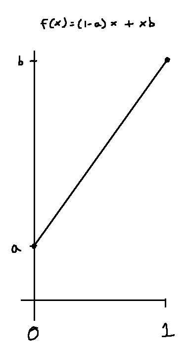
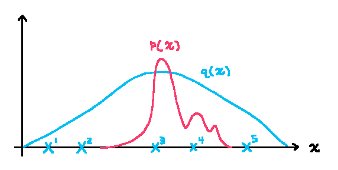
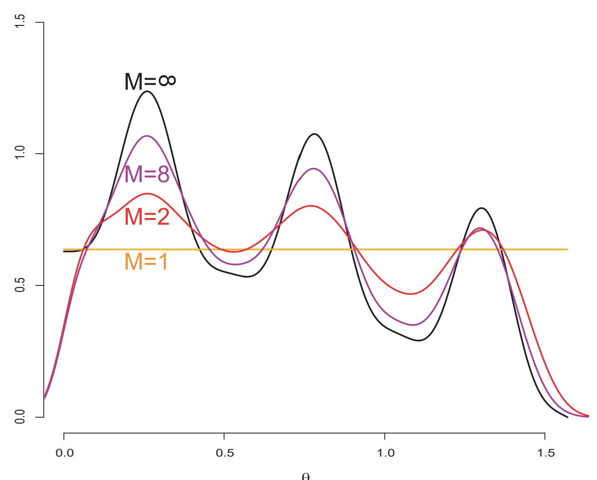

- [Probability Part I]()
- [Probability Part II]()
- [Probability Part III]() $\leftarrow$ you are here

$$
\gdef\dx{\thinspace \mathrm{d}x}
\gdef\dm{\thinspace \mathrm{d}m}
\gdef\dr{\thinspace \mathrm{d}r}
\gdef\dt{\thinspace \mathrm{d}t}
\gdef\iidsim{\overset{\mathrm{iid}}{\sim}}
$$

$\gdef\dx{\thinspace \mathrm{d}x}$
$\gdef\dm{\thinspace \mathrm{d}m}$
$\gdef\dr{\thinspace \mathrm{d}r}$
$\gdef\dt{\thinspace \mathrm{d}t}$
$\gdef\iidsim{\overset{\mathrm{iid}}{\sim}}$

## Intro

In [Part I](), and [Part II](), we built up from the basics to **random variables** and **Monte Carlo integration**. In this post we will expand on **Monte Carlo integration** with sampling using the **inversion method**, **importance sampling**, and **importance resampling**.

## Inversion Method Sampling


Recall that **Monte Carlo integration** tells us that we can estimate an integral but averaging 
**random variables** divided by their probability distributions.


$$
\widehat{I}^{(n)}
=
\frac{1}{n}\sum_{i=1}^n\frac{f(X_i)}{p(X_i)}
\approx
\int f(x) \dx
$$


However, these random samples must still be drawn from said distribution? How do we draw from $p$? One important method is the **inversion method**, which maps uniform samples from $[0,1)$ to the given probability distribution by inverting the CDF.

There's a couple things I want to elaborate on related to https://pbr-book.org/4ed/Monte_Carlo_Integration/Sampling_Using_the_Inversion_Method.

In the example where they sample a linear function defined over $[0,1]$, given $a,b \ge 0$
$$
f(x) = (1-x)a + xb
$$



Here, $f(x)$ is an unnormalized density that defines the shape of the distribution we want to sample from, _not_ the integral we are trying to esatimate using Monte Carlo.

- The x-axis here is the sample value $x$.
- The y-axis here is the unnormalized density $f(x)$ of the sample. We want to normalize it to get a **PDF** $p(x)$.

So the first thing they do here is integrate the function. This isn't to compute the CDF, the goal here instead is to get the total "weight". The inverse of this weight is a normalization constant - multiplying the original function by the normalization constant produces a function whose integral is $1$, this way it can be used as a PDF. 

This integral is given by


$$
\begin{aligned}
\int_0^1 f(x) \dx &= \int_0^1 \left( (1-x)a+xb \right) \dx
             \\[1em] &= a \int_0^1 (1-x) \dx + b \int_0^1 x \dx
             \\[1em] &= a \left[ x - \frac{x^2}{2} \right]_0^1 +  b \left[ \frac{x^2}{2} \right]_0^1
             \\[1em] &= \frac{a}{2} + \frac{b}{2}
             \\[1em] &= \frac{a+b}{2}.
\end{aligned}
$$


So $f(x)$ is normalized by dividing by its integral to give the PDF


$$
\begin{aligned}
p(x)    &= \frac{   f(x) }{\int_0^1 f(x) \dx} 
\\[1em] &= \frac{   f(x) }{ \left( \frac{a+b}{2} \right)  } 
\\[1em] &= \frac{ 2 f(x) }{ a+b}.
\end{aligned}
$$



Now the PDF can be integrated from $0$ to $x$ to give its CDF


$$
\begin{aligned}
P(x)    &= \int_0^x p(x') \dx'
\\[1em] &= \int_0^x \left( \frac{ 2 f(x') }{ a+b} \right) \dx'
\\[1em] &= \frac{2}{a+b} \int_0^x  f(x') \dx'
\\[1em] &= \frac{2}{a+b} \int_0^x \left( (1-x')a+x' b \right) \dx'
\\[1em] &= \frac{2}{a+b} \left( a \int_0^x (1-x') \dx' + b \int_0^x x' \dx' \right)
\\[1em] &= \frac{2}{a+b} \left( a \left[ x' - \frac{x'^2}{2} \right]_0^x + b \left[ \frac{x'^2}{2} \right]_0^x \right)
\\[1em] &= \frac{2}{a+b} \left( a \left[ x - \frac{x^2}{2} \right]     + b \left[ \frac{x^2}{2} \right]     \right)
\\[1em] &= \frac{ a \left[ 2x - x^2 \right] + b x^2  }{a+b} 
\\[1em] &= \frac{ x\left( a \left[ 2 - x \right] + b x \right) }{a+b} 
\end{aligned}
$$


Inverting $\xi=P(X)$ to solve for $X$ is the same as in [PBRT](https://pbr-book.org/4ed/Monte_Carlo_Integration/Sampling_Using_the_Inversion_Method).

## Types of estimators

Note: $X\sim p$ means samples $X$ are drawn from distribution $p$.



Given the following two estimators, $\hat{I}$ and $\hat{\mu}$, what is the difference between them?


$$
\hat{I} = \frac{1}{n} \sum_{i=1}^n \frac{ f(X_i) }{p(X_i)}, \quad X_i \iidsim p
$$



$$
\hat{\mu} = \frac{1}{n} \sum_{i=1}^n f(X_i), \quad X_i \iidsim p.
$$


Well, we've seen $\hat{I}$ before - it estimates the integral $I$
$$
I = E_p \left[ \frac{f(X)}{p(X)} \right] = \int f(x) \dx.
$$

Whereas $\hat{\mu}$ estimates the **expected value** $\mu$
$$
\mu = E_p[ f(X) ] = \int f(x) \thinspace p(x) \dx.
$$

The point is that these estimators use the same samples but estimate different quantities.

## Importance Sampling (IS)


For **importance sampling**, we're going to focus on the **expected value** estimator $\hat{\mu}$.


$$
\begin{aligned}
\mu &= E_p[ f(X) ] = \int f(x) \thinspace p(x) \dx
\\[1em]\hat{\mu} &= \frac{1}{n} \sum_{i=1}^n f(X_i), \quad X_i \iidsim p.
\end{aligned}
$$


**Importance sampling** is a technique where we generate samples from an *importance distribution* $q$, also called a *proposal distribution*, instead of from $p$. Maybe $p$ is hard to sample from, but easy to evaluate. Maybe the shape of $q$ can be chosen to reduce variance. In any case, we require $q(x) > 0$ wherever $f(x)\thinspace p(x) \neq 0$.


$$
\begin{aligned}
E_p[ f(X) ] &= \int f(x) \thinspace p(x) \dx
 \\[1em] &= \int \frac{ f(x) \thinspace p(x) }{ q(x) } q(x) \dx
\\[1em] &= E_q \left[ \frac{ f(X) \thinspace p(X)}{ q(X) } \right]
\\[1em] &\approx \frac{1}{n} \sum_{i=1}^n \frac{ f(X_i) \thinspace p(X_i)  } { q(X_i) }, \quad X_i \iidsim q
\end{aligned}
$$


Now the *importance weight* $w$

$$
w(x) = \dfrac{p(x)}{q(x)}
$$

corrects for sampling from $q$ instead of $p$, so the weighted sample average still estimates $E_p[f(X)]$.

Rewritten in terms of $w$, our estimator becomes:


$$
\begin{aligned}
E_p[ f(X) ] &= E_q \left[ f(X) \thinspace w(X) \right]
\\[1em] &\approx \frac{1}{n} \sum_{i=1}^n f(X_i) \thinspace w(X_i) , \quad X_i \iidsim q
\end{aligned}
$$


<!--

## Variance of Importance Sampling

// ----------------------------------------
//                   TODO 
// ----------------------------------------

-->

## Importance Resampling (IR)

**Importance Resampling** (IR), also known as **Sampling Importance Resampling** (SIR), is a method that can generate samples from a difficult distribution $p$. It does so by first sampling from an easier distribution $q$, then resampling those with probabilities proportial to their importance weights.





So for example say we start out with $N=5$ distinct *proposal samples* $X^i$

$$
\left( X^1, X^2, X^3, X^4, X^5 \right) \iidsim q
$$

and these may be resampled into *resampled samples* $\widetilde{X}^i$
$$
\left( \widetilde{X}^1, \widetilde{X}^2, \widetilde{X}^3, \widetilde{X}^4, \widetilde{X}^5 \right)= \left( X^3, X^3, X^3, X^4, X^4 \right)
$$

Each resampling draw $\widetilde{X}$ selects *proposal sample* $X^i$ with probability proportional to its *importance weight* $w(X^i)$.


$$
\begin{aligned}
\Pr( \widetilde{X} = X^i ) &\propto w( X^i ),
\end{aligned}
$$


where $w(X^i)$, the *importance weight*, is the same from the previous **importance sampling** section
$$
w(X^i) = \dfrac{p(X^i)}{q(X^i)}.
$$


To make these probabilities sum to $1$, we must normalize the *importance weights*. The result, $\tilde{w}(X^i)$, is the *normalized importance weight*.
$$
\Pr( \widetilde{X} = X^i ) = \frac{ w(X^i)}{\sum_{j=1}^N w(X^j) } = \tilde{w}(X^i)
$$

The probability that a single resampled sample $\widetilde{X}$ falls into the interval $A=[a,b]$ is:


$$
\begin{aligned}
\Pr( \widetilde{X} \in A ) &= \sum_{i=1}^N \Pr( \widetilde{X} = X^i ) \,  1_{\lbrace X^i \in A \rbrace }
\\[1.5em] &= \sum_{i=1}^N \widetilde{w}(X^i) \,  1_{\lbrace X^i \in A \rbrace }
\\[1.5em] &= \sum_{i=1}^N \left(  \frac{w(X^i)}{\sum_{j=1}^N w( X^j)} \right) \,  1_{\lbrace X^i \in A \rbrace }
\\[1.5em] &= \frac{ \sum_{i=1}^N w(X^i) \,  1_{\lbrace X^i \in A \rbrace } }
                  { \sum_{j=1}^N w(X^j)}
\\[1.5em] &= \frac{ \frac{1}{N} \sum_{i=1}^N w(X^i) \,  1_{\lbrace X^i \in A \rbrace } }
                  { \frac{1}{N} \sum_{j=1}^N w( X^j) }
\end{aligned}
$$


By the way, $1_{\lbrace X^i \in A \rbrace}$ is an _indicator variable_, it's defined as:


$$
1_{\{X^i \in A \}} =
\begin{cases}
1, & \text{if } X^i \in A,\\
0, & \text{otherwise}.
\end{cases}
$$



Due to the **Law of Large Numbers**,


$$
\begin{aligned}
\Pr( \widetilde{X} \in A ) &= \frac{ \frac{1}{N} \sum_{i=1}^N w(X^i) \,  1_{\lbrace X^i \in A \rbrace } }
                                       { \frac{1}{N} \sum_{j=1}^N w( X^j) }
\\[2em] &\xrightarrow[N \to \infty]{} \frac{ \mathbb{E}_q \left[w(X) \,  1_{\lbrace X \in A \rbrace }\right] }
                                           { \mathbb{E}_q \left[w(X) \right] }.
\end{aligned}
$$


As $N \to \infty$, the denominator converges to $1$


$$
\begin{aligned}
\mathbb{E}_q \left[w(X) \right] &= \mathbb{E}_q \left[ \frac{ p(X) }{ q(X) } \right]
\\ &= \int \frac{ p(x)}{q(x)} \,  q(x) \dx
\\ &= \int p(x) \dx
\\ &= 1.
\end{aligned}
$$


Leaving just the numerator as $N \to \infty$, which converges to $\int_A p(x) \dx$.


$$
\begin{aligned}
\Pr( \widetilde{X} \in A )

&=  \frac{1}{N} \sum_{i=1}^N w(X^i) \,  1_{\lbrace X^i \in A \rbrace }
\\ & \xrightarrow[N \to \infty]{} \mathbb{E}_q \left[w(X) \,  1_{\lbrace X \in A \rbrace }\right]
\\ &= \mathbb{E}_q \left[ \frac{p(X)}{q(X)} \,  1_{\lbrace X \in A \rbrace }\right] 
\\ &= \int \frac{p(x)}{q(x)} \,  1_{\lbrace x \in A \rbrace } \, q(x) \dx
\\ &= \int p(x) \,  1_{\lbrace x \in A \rbrace } \dx
\\ &= \int_A p(x) \dx
\end{aligned}
$$


Thus, for sufficiently large $N$,
$$
\widetilde{X} \mathrel{\dot\sim} p
$$

This graph from [Talbot (2005)](#sources), shows this convergence.




IR pros:
- IR can generate samples approximately proportional to complicated functions like $L\thinspace f_r \cos(\theta)$ just by evaluating the function and using a suitable proposal sampler $q$.
- IR doesn't require the target function $p$ to be normalized.

A major con of IR is PDF _intractability_. 

Although $\widetilde{X}$ is approximately distributed according to $p$, its exact PDF, $p_{\widetilde{X}}$, is generally intractable to evaluate - we don't even know what it is!  So using $p(\widetilde{X})$ instead of $p_{\widetilde{X}}(\widetilde{X})$ generally introduces bias without some magical correction factor... more on that later.

### IR Example


Say we want to generate samples approximately distributed according to target distribution $p$ on the interval $A=[0,5]$, with density


$$
\begin{aligned}
p_0(x) &= | x(x-2)(x-4)(x-5) |.
\\[1em]Z_p &=\int_A p_0(x) \dx
\\[1em] p(x) &= \frac{ p_0(x) }{ Z_p }
\end{aligned}
$$


Although $p(x)$ is easy to evaluate, it's nontrivial to sample from. So instead let's sample from a linear proposal distribution $q$, then resample using importance weights.


$$
\begin{aligned}
q_0(x) &= 12-2x,
\\[1em] Z_q &= \int_A q_0(x) \dx 
\\[1em] q(x) &= \frac{q_0(x)}{Z_q}
\\[1em]      &= \frac{12-2x}{35}
\end{aligned}
$$


To sample from $q$, first we need the CDF ${F_q}$


$$
\begin{aligned}
F_q(x) &= \int_0^x q(t) \dt
\\[1em] &= \int_0^x \frac{12-2t}{35} \dt
\\[1em] &= \frac{1}{35}\int_0^x 12-2t \dt
\\[1em] &= \frac{1}{35} \left(\int_0^x 12 \dt  - \int_0^x 2t \dt  \right)
\\[1em] &= \frac{1}{35} \left( \left[  12t \right]_0^x - \left[ t^2 \right]_0^x  \right)
\\[1em] &= \frac{12x  - x^2}{35}, \quad x \in [0,5]
\end{aligned}
$$



And then we need its inverse ${F_q^{-1}}$

$$
x = F_q(F_q^{-1}(x)) = \frac{  12 F_q^{-1}(x) - (F_q^{-1}(x))^2}{35}
$$

Substituting $y= F_q^{-1}(x)$,


$$
x = \frac{  12 y - y^2}{35} 
\\[1em] y^2 - 12y + 35x = 0
$$


Which can be solved by the quadratic formula
$$
y= 6 \pm \sqrt{36-35x}
$$
We need $y \in [0,5]$, so we choose the minus sign
$$
F_q^{-1}(x) =  6 - \sqrt{36-35x}, \quad x \in [0,1]
$$

A sample $X \sim q$ is generated by

$$
\xi \sim \operatorname{Uniform}(0,1)
\\[1em] X = F_q^{-1}(\xi)
$$


We put this in the function `Sample_from_q` and use it to draw our proposal samples $\lbrace X^1, \dots, X^N \rbrace$.
Next, we draw $\widetilde{X}$ by selecting $X^i$ with probability

$$
\Pr( \widetilde{X} = X^i ) = \frac{w(X^i)}{\sum_{j=1}^N w(X^j)}
$$

This can be done by passing the $\dfrac{p_0(x)}{q_0(x)}$ as the weights to `std::discrete_distribution` instead of $\dfrac{p(x)}{q(x)}$, as the common factor $\dfrac{Z_q}{Z_p}$ cancels out during normalization.

```cpp
#include <array>
#include <random>
#include <cmath>

std::default_random_engine rng{ 0 };
std::uniform_real_distribution< float > u{};

float p_0( float x )
{
   return std::abs( x * ( x - 2 )* ( x - 4 )* ( x - 5 ) );
}

float q_0( float x )
{
   return 12 - 2 * x;
}

float Sample_from_q()
{
   float xi { u( rng ) };
   return 6 - std::sqrt( 36 - 35 * xi );
}

int main()
{
   const int N{ 10 };
   std::array< float, N > proposal_samples{}; // ~ q
   std::array< float, N > resampled_samples{}; // approximately ~ p
   std::array< float, N > importance_weights{};
   
   for( int i{}; i < N; ++i )
   {
      const float X{ Sample_from_q() };
      proposal_samples[ i ] = X;
      importance_weights[ i ] = p_0( X ) / q_0( X );
   }

   std::discrete_distribution< int > normalized_importance(
      importance_weights.begin(),
      importance_weights.end() );

   for( int i{}; i < N; ++i)
   {
      const int j { normalized_importance( rng ) };
      resampled_samples[ i ] = proposal_samples[ j ];
   }
}
```


## Resampled Importance Sampling (RIS)

**Resampled Importance Sampling (RIS)** builds upon **Importance Resampling (IR/SIR)** to reduce variance for Monte Carlo integration.

That's right. In a stroke of naming genius, we have two related techniques:
- Sampling Importance Resampling (SIR) / Importance Resampling (IR)
- Resampled Importance Sampling (RIS)

That's not confusing at all...

Anyway, we want to estimate an integral

$$
I = \int_\Omega f(x) \dx
$$

The normal Monte Carlo estimator $\hat{I}_{MC}$ works when $p$ is normalized and is easy to sample from.

$$
I \approx \hat{I}_{MC} = \frac{1}{N}\sum_{i=1}^N \frac{ f( X^i ) }{p(X^i)}
$$

The **Resampled Importance Sampling** Monte Carlo estimator uses **SIR** to generate samples $\widetilde{X}$, and a a weighting function $w^*$ to correct for the fact that the samples are only approximately distributed according to $p$, and that $p$ is unnormalized.

$$
\hat{I}_{RIS} = \frac{1}{N}\sum_{i=1}^N
\frac
{ f( \widetilde{X}^i ) }
{ p( \widetilde{X}^i ) }
\,
w^*
$$

where the weighting function is simply an average of all the IR importance weights of the proposal samples $X^i$

<!-- normalized importance weight or nah? -->
$$
w^* = \frac{1}{N}\sum_{i=1}^N w( X^i )
    = \frac{1}{N}\sum_{i=1}^N \frac{p(X^i)}{q(X^i)}
$$

The basic RIS estimator is thus

$$
\hat{I}_{RIS} =
\frac{1}{N}\sum_{i=1}^N
\left( \frac { f( \widetilde{X}^i ) } { p( \widetilde{X}^i ) } \right)
\cdot
\frac{1}{N}\sum_{i=1}^N \frac{p(X^i)}{q(X^i)}
$$

<!-- Separate M proposal from N samples? -->


## Sources


- [Sampling Using the Inversion Method - PBRT, 4th ed.](https://pbr-book.org/4ed/Monte_Carlo_Integration/Sampling_Using_the_Inversion_Method)

- [Improving Efficiency - PBRT, 4th ed.](https://pbr-book.org/4ed/Monte_Carlo_Integration/Improving_Efficiency)

- [Importance Sampling - Monte Carlo Theory, Methods and Examples, Art B. Owen, ch. 9](https://artowen.su.domains/mc/Ch-var-is.pdf)

- [SMC tutorial 2: the need to resample when using Importance Sampling - Peter Green, Distributed Algorithms CDT](https://www.youtube.com/watch?v=PNhA5mxZ6yE)

- [Understanding the math behind ReSTIR DI - Jiayin Cao](https://agraphicsguynotes.com/posts/understanding_the_math_behind_restir_di)

- [Importance Resampling for Global Illumination - Justin F. Talbot](https://scholarsarchive.byu.edu/cgi/viewcontent.cgi?article=1662&context=etd) 
